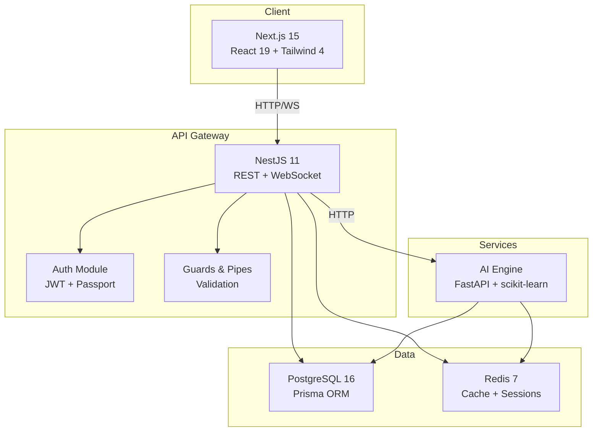

<div align="center">

# 🏨 Hotel OS

### Enterprise-Grade Hotel Management & Booking SaaS Platform

[](https://github.com/hotel-os/hotel-os/actions/workflows/ci.yml)
[](LICENSE)
[](https://nodejs.org/)
[](https://www.typescriptlang.org/)

**Hotel OS** is a full-stack, AI-powered hotel management system built for modern hospitality businesses. From front-desk operations to revenue management, Hotel OS streamlines every aspect of hotel operations with an intuitive interface and intelligent automation.

[Quick Start](#-quick-start) · [Features](#-features) · [Documentation](#-api-documentation) · [Contributing](CONTRIBUTING.md)

</div>

---

## ✨ Features

- **🏠 Property Management** — Multi-property support, room types, floor plans, and amenity management
- **📅 Reservation System** — Real-time availability, booking engine, channel manager integration
- **🛎️ Front Desk Operations** — Check-in/check-out, room assignment, guest profiles, and housekeeping coordination
- **💳 Billing & Invoicing** — Automated billing, split payments, tax management, and Stripe integration
- **📊 Revenue Management** — AI-powered dynamic pricing, occupancy forecasting, and rate optimization
- **👥 Guest Experience** — Guest profiles, preferences, loyalty programs, and communication hub
- **📈 Analytics Dashboard** — Real-time KPIs, occupancy trends, revenue reports, and custom dashboards
- **🤖 AI Engine** — Demand forecasting, pricing recommendations, and guest sentiment analysis
- **🔐 Role-Based Access** — Granular permissions for admin, manager, front-desk, housekeeping, and more
- **🌐 Multi-language & Multi-currency** — Internationalization-ready architecture

## 🛠️ Tech Stack

| Layer | Technology |
|---|---|
| **Frontend** | Next.js 15, React 19, Tailwind CSS 4, shadcn/ui, Recharts |
| **Backend** | NestJS 11, Prisma ORM, Passport.js, Redis |
| **Database** | PostgreSQL 16 |
| **AI/ML** | FastAPI, scikit-learn, pandas, NumPy |
| **Infrastructure** | Docker, Turborepo, GitHub Actions |
| **Language** | TypeScript 5.7, Python 3.13 |

## 🏗️ Architecture



## 🚀 Quick Start

### Prerequisites

- **Node.js** ≥ 20 (recommended: 24)
- **npm** ≥ 11
- **Python** ≥ 3.13 (for AI engine)
- **Docker & Docker Compose** (for database services)

### 1. Clone & Install

```bash
git clone https://github.com/hotel-os/hotel-os.git
cd hotel-os
npm install
```

### 2. Set Up Environment

```bash
cp .env.example .env
# Edit .env with your configuration
```

### 3. Start Database Services

```bash
cd docker
docker compose up -d postgres redis
cd ..
```

### 4. Initialize Database

```bash
npm run db:generate
npm run db:push
npm run db:seed
```

### 5. Start Development Servers

```bash
npm run dev
```

This starts all services concurrently:
- 🌐 **Web**: http://localhost:3000
- 🔌 **API**: http://localhost:4000
- 🤖 **AI Engine**: http://localhost:8000

## 🐳 Docker (Full Stack)

Run the entire platform with a single command:

```bash
cd docker
docker compose up --build
```

## 📂 Project Structure

```
hotel-os/
├── apps/
│   ├── web/                 # Next.js 15 frontend
│   │   ├── app/             # App Router pages & layouts
│   │   ├── src/             # Components, hooks, stores
│   │   └── public/          # Static assets
│   └── api/                 # NestJS 11 backend
│       ├── src/
│       │   ├── modules/     # Feature modules (auth, rooms, bookings…)
│       │   ├── common/      # Guards, pipes, decorators, filters
│       │   └── config/      # App configuration
│       └── test/            # E2E tests
├── packages/
│   ├── database/            # Prisma schema, client, migrations, seed
│   ├── shared/              # Shared types, constants, validators
│   └── ui/                  # Shared UI components (shadcn/ui based)
├── services/
│   └── ai-engine/           # FastAPI ML service
├── docker/                  # Dockerfiles & docker-compose
├── .github/                 # CI/CD workflows & templates
├── turbo.json               # Turborepo pipeline config
├── tsconfig.base.json       # Shared TypeScript config
└── package.json             # Monorepo root
```

## 🔑 Demo Credentials

| Role | Email | Password |
|------|-------|----------|
| **Admin** | `admin@hotel-os.dev` | `HotelOS@2024` |
| **Manager** | `manager@hotel-os.dev` | `HotelOS@2024` |
| **Front Desk** | `frontdesk@hotel-os.dev` | `HotelOS@2024` |

## 📖 API Documentation

Once the API server is running, interactive API documentation is available at:

- **Swagger UI**: http://localhost:4000/api/docs
- **OpenAPI JSON**: http://localhost:4000/api/docs-json

## 🤝 Contributing

We welcome contributions! Please see our [Contributing Guide](CONTRIBUTING.md) for details on:

- Development workflow
- Code style guidelines
- Commit conventions
- Pull request process

## 🔒 Security

For security concerns, please see our [Security Policy](SECURITY.md). Do **not** open public issues for security vulnerabilities.

## 📄 License

This project is licensed under the **Apache License 2.0** — see the [LICENSE](LICENSE) file for details.

## 🗺️ Roadmap

- [x] Core property & room management
- [x] Reservation & booking engine
- [x] Guest profile management
- [x] Billing & invoicing with Stripe
- [x] AI-powered dynamic pricing
- [x] Analytics dashboard with Recharts
- [ ] Channel manager integrations (OTAs)
- [ ] Mobile app (React Native)
- [ ] Multi-property chain management
- [ ] POS integration for restaurants & spa
- [ ] Housekeeping mobile workflow
- [ ] Guest self-service portal & kiosk mode
- [ ] Advanced revenue management (RMS)
- [ ] IoT integration (smart locks, thermostats)

---

<div align="center">
  <strong>Built with ❤️ for the hospitality industry</strong>
</div>
